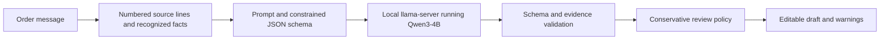

# How FOM AI works

FOM AI is the extraction and evaluation component separated from FOM Platform. We use pretrained model weights; we have not fine-tuned them. Adding a fixture, editing a prompt, or correcting a draft does not train the model.

## Request flow

1. The CLI or library receives the original message. Input must be 5–5,000 characters.
2. Source policies recognize limited phone corrections, product blocks, quantities, variants, addresses and fulfillment notes. Unrecognized formats still depend on the model. These are rules, not training.
3. The model receives numbered lines and a schema. It references source lines; code constructs quotations from the original input.
4. The service tokenizes the rendered prompt, reserves output capacity within 8,192 context tokens, and requests at most 2,048 output tokens. Thinking is disabled. The total request deadline is 60 seconds.
5. Validation rejects extra fields, unsupported evidence/numbers, incomplete responses, and other contract violations. No automatic retry, repair, or rule-parser fallback occurs.
6. The review policy can withhold an ambiguous price and explain why. Missing values remain null, explicit zero stays zero, and phone numbers stay strings.
7. The caller receives a draft. Human review and order creation belong to the host application.

`llama.cpp` is the external inference engine, written in C/C++. We download a pinned executable called `llama-server`; there is no need for `.cpp` source in this repository. The `.gguf` file contains pretrained Qwen weights. Source rules and prompts live here. These are three different components.

## Ownership

| FOM AI | FOM Platform |
| --- | --- |
| Extraction contract, prompts, policies, validation | Authentication and tenant permissions |
| Local model/runtime configuration | Plan entitlements and shop lifecycle |
| Dataset review, scoring and experiments | Customer matching/restoration |
| Drafts, evidence and warnings | Review UI, order writes, audit and outbox |

The existing FOM web flow remains in FOM Platform. The initial import did not redirect its requests; the subsequent service integration is explicit opt-in. In legacy local mode, the API connects to the model launcher's loopback URL and executes its own extraction copy. In service mode, it calls the FOM AI wrapper, which executes this repository's implementation.

The opt-in HTTP boundary now supplies service authentication, one-request concurrency, cancellation, sanitized diagnostics and container packaging. FOM Platform has a gated client for it. See [service deployment](service-deployment.md). Capacity evaluation, independent extraction review and customer rollout remain separate gates; never expose the model runtime publicly.

## Explicit township policy

The current source rules additionally recognize a numbered unlabelled address with an explicit township marker and supported city ending, and narrow English/Myanmar delivery instructions. They constrain only the township and its exact original line. Street names such as “Township Road,” competing markers, recognized conditional/correction wording and separate address/township fields prevent the new constraint.

For a fully recognized single-product conversation where every line has a known role and the destination contains only a township, the output schema requires absent customer name and full address to remain null. Additional identity/address/unknown lines disable this absence rule. This is source-derived schema construction, not training, post-generation repair or a general ability to prove information absent from arbitrary messages.

See the [measured decision](../tools/ai-evaluation/reports/TOWNSHIP-ONLY-DECISION.md) for the initial regression, final comparison and remaining limits.

## Compact slash-separated items

The item source policy recognizes complete rows such as `Product Cup / Color Blue / Qty 2 / Unit price 1000`, including supported Myanmar labels and digit quantities. Slashes inside parentheses or product names such as `AC/DC` stay literal. Each mapped item carries its own original line references; the schema and validator prevent missing items, crossed references and changed numeric values.

The map is used only when every line has a supported role. Duplicate fields, ambiguous alternatives, unknown lines, mixed incomplete formats and recognized corrections decline this new constraint. Missing values stay null, zero stays zero, and an unqualified amount for multiple units remains unknown. This is a finite source policy, not model training or a repair after generation.

The [measured result](../tools/ai-evaluation/reports/COMPACT-SLASH-DECISION.md) improves item/numeric coverage but leaves customer-label/township and payment-note errors in the target message. Do not interpret a successful response as confirmation that every field is correct.

## Evaluation versus application

The Python `fom_eval` package retains the original benchmark algorithm. `prototype_eval` calls the current TypeScript extraction service. These have different prompts/output handling, so their scores are not interchangeable. The rule parser is a baseline, never ground truth.

All published datasets are synthetic or anonymized development adaptations with provenance. Language review remains incomplete. Historical 120-case held-out results describe their original experiment; those now-public cases must not become a fresh promotion gate after tuning.

Raw runs and private datasets live outside the checkout. Reports describe errors, completeness, latency and sampled process memory, with machine-specific limitations. New source/dependency changes need new runs. See [migration](migration.md), [evaluation](../tools/ai-evaluation/README.md), and [roadmap](../ROADMAP.md).
