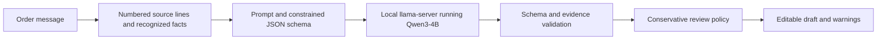

# How FOM AI works

FOM AI is the extraction and evaluation component separated from FOM Platform. We use pretrained model weights; we have not fine-tuned them. Adding a fixture, editing a prompt, or correcting a draft does not train the model.

## Request flow

1. The CLI or library receives the original message. Input must be 5–5,000 characters.
2. Source policies recognize limited phone corrections, product blocks, quantities, variants, addresses and fulfillment notes. Unrecognized formats still depend on the model. These are rules, not training.
3. The model receives numbered lines and a schema. It references source lines; code constructs quotations from the original input.
4. The service tokenizes the rendered prompt, reserves output capacity within 8,192 context tokens, and requests at most 2,048 output tokens. Thinking is disabled. The total request deadline is 60 seconds.
5. Validation rejects extra fields, unsupported evidence/numbers, incomplete responses, and other contract violations. No automatic retry, repair, or rule-parser fallback occurs.
6. The review policy can withhold an ambiguous price and explain why. Missing values remain null, explicit zero stays zero, and phone numbers stay strings.
7. The caller receives a draft. Human review and order creation belong to the host application.

`llama.cpp` is the external inference engine, written in C/C++. We download a pinned executable called `llama-server`; there is no need for `.cpp` source in this repository. The `.gguf` file contains pretrained Qwen weights. Source rules and prompts live here. These are three different components.

## Ownership

| FOM AI | FOM Platform |
| --- | --- |
| Extraction contract, prompts, policies, validation | Authentication and tenant permissions |
| Local model/runtime configuration | Plan entitlements and shop lifecycle |
| Dataset review, scoring and experiments | Customer matching/restoration |
| Drafts, evidence and warnings | Review UI, order writes, audit and outbox |

The existing FOM web flow remains in FOM Platform. This initial repository import does not change its dependency or redirect its requests. Starting this repository's launcher prints a loopback URL that the existing development API can use, but the API still executes its own copy of extraction code.

The next integration should use a versioned boundary with parity tests. A future service additionally needs authentication, bounded concurrency, cancellation, safe diagnostics, deployment support and capacity evaluation. Those are not supplied by today's CLI. Do not expose the current loopback runtime publicly.

## Evaluation versus application

The Python `fom_eval` package retains the original benchmark algorithm. `prototype_eval` calls the current TypeScript extraction service. These have different prompts/output handling, so their scores are not interchangeable. The rule parser is a baseline, never ground truth.

All published datasets are synthetic or anonymized development adaptations with provenance. Language review remains incomplete. Historical 120-case held-out results describe their original experiment; those now-public cases must not become a fresh promotion gate after tuning.

Raw runs and private datasets live outside the checkout. Reports describe errors, completeness, latency and sampled process memory, with machine-specific limitations. New source/dependency changes need new runs. See [migration](migration.md), [evaluation](../tools/ai-evaluation/README.md), and [roadmap](../ROADMAP.md).
